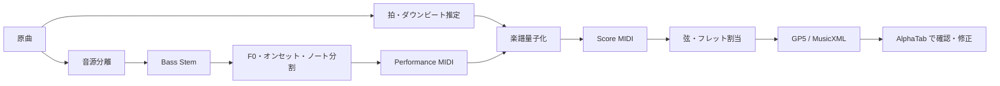

# Stem2Tab

GP5 generation preserves the mapped note sequence in one Bass track without
PyGuitarPro's blank default containers. This fixes missing GP5 notes; the current
fixed tuning/range and sequential quarter-note timing remain limited. See the
[focused regression procedure](docs/TESTING.md#gp5-container-regression).

音源ファイルからベースラインを抽出し、修正可能なMIDIとTab譜（Guitar Pro / MusicXML）を生成するWebアプリケーション。

通常の音声ジョブが完了したら「生成MIDIから原時刻の五線譜・TAB・任意補正へ」から進めます。
元MIDIを保持し、必要なときだけ運指・明示量子化・リズムGP5の別版を選択します。
[統合範囲とクラウド検証](docs/evaluation/CLOUD_INTEGRATION.md) を参照してください。

## 概要



既存のDemucs→Basic Pitch→GP5/MusicXML処理はWebフローを検証するためのベースラインです。
現在の最優先事項は採譜品質を測定・比較できる評価基盤であり、実装順序は
[開発ロードマップ](docs/ROADMAP.md) と [Issue #1](https://github.com/tehutahu/Stem2Tab/issues/1)
を正本とします。

## プロジェクト構造

```
Stem2Tab/
├── docker-compose.yml         # GPU版（標準）
├── docker-compose.cpu.yml     # CPU版
├── .env.example               # 環境変数テンプレート
├── backend/                   # Python バックエンド
│   ├── Dockerfile
│   ├── pyproject.toml         # uv 用
│   ├── src/
│   │   ├── api/               # FastAPI ルート
│   │   ├── evaluation/        # 採譜ベンチマーク、共通ノート、評価指標
│   │   ├── pipelines/         # 現行の分離、採譜、Tab出力
│   │   ├── worker/            # Celeryタスク
│   │   └── core/              # 設定、ログ
│   └── tests/
├── frontend/                  # React フロントエンド
│   ├── Dockerfile
│   ├── package.json
│   └── src/
│       ├── components/        # AlphaTab, Fretboard 等
│       ├── hooks/
│       └── pages/
├── docs/                      # ドキュメント
├── data/                      # 成果物保存先 (gitignore)
└── AGENTS.md                  # AIエージェント用ルール
```

## 技術スタック

| レイヤー | 技術 |
|:---|:---|
| **音源分離** | [Demucs](https://github.com/facebookresearch/demucs) (Hybrid Transformer v4) |
| **採譜ベースライン** | [Basic Pitch](https://github.com/spotify/basic-pitch) (ONNX)。今後F0方式と比較 |
| **Tab生成** | [PyGuitarPro](https://pyguitarpro.readthedocs.io/), [music21](https://web.mit.edu/music21/doc/) |
| **バックエンド** | FastAPI + Celery + Redis |
| **フロントエンド** | React + Vite + [AlphaTab](https://alphatab.net/) |
| **パッケージ管理** | [uv](https://docs.astral.sh/uv/) |

## 前提環境と確認方法

- OS: Ubuntu 22.04+/24.04（WSL可）
- Docker: 29+（`docker --version`）
- Docker Compose: v2（`docker compose version`）
- Python: 3.11+（`python3 --version`） ※パッケージは必ず uv を使用
- uv: `uv --version`（未導入なら `curl -LsSf https://astral.sh/uv/install.sh | sh`）
- Node.js: 20.19+ または 22.12+（`node -v`）, npm: `npm -v`
- Git: `git --version`
- GPU 利用時: NVIDIA ドライバ + NVIDIA Container Toolkit（`nvidia-smi` がホストで動作し、下記コンテナ確認が通ること）

動作確認コマンド例:

```bash
python3 --version
uv --version
node -v && npm -v
docker --version && docker compose version
nvidia-smi  # GPUマシンのみ
docker run --rm --gpus all nvidia/cuda:11.8.0-base-ubuntu22.04 nvidia-smi  # GPUパススルー確認
```

## クイックスタート

```bash
# リポジトリをクローン
git clone https://github.com/tehutahu/Stem2Tab.git
cd Stem2Tab

# 環境変数の設定
cp .env.example .env

# Docker Compose で起動 (GPU版)
docker compose up --build

# CPUのみの場合
docker compose -f docker-compose.cpu.yml up --build

# ブラウザでアクセス
open http://localhost:5173
```

> [!NOTE]
> GPUを使用する場合は NVIDIA Container Toolkit が必要です。
> 詳細は [INFRASTRUCTURE.md](docs/INFRASTRUCTURE.md) を参照してください。

## ドキュメント

| ドキュメント | 内容 |
|:---|:---|
| [ROADMAP.md](docs/ROADMAP.md) | **現在の実装優先順位、評価データの判断事項** |
| [ARCHITECTURE.md](docs/ARCHITECTURE.md) | システム構成、コンポーネント、デプロイ |
| [DATAFLOW.md](docs/DATAFLOW.md) | パイプライン処理、ジョブ状態管理 |
| [FEATURES.md](docs/FEATURES.md) | 機能一覧、Phase別ロードマップ |
| [IMPLEMENTATION.md](docs/IMPLEMENTATION.md) | 実装計画、依存関係、環境変数 |
| [DEPENDENCIES.md](docs/DEPENDENCIES.md) | 外部ライブラリ、モデル管理、互換性 |
| [TESTING.md](docs/TESTING.md) | テスト戦略、CI/CD |
| [DEMO_MODE.md](docs/DEMO_MODE.md) | 演奏デモモード機能仕様 |
| [TECH_RESEARCH.md](docs/TECH_RESEARCH.md) | 技術スタック調査レポート |
| [INFRASTRUCTURE.md](docs/INFRASTRUCTURE.md) | **Docker Compose, Dockerfile, 環境変数** |
| [DEVELOPMENT_RULES.md](docs/DEVELOPMENT_RULES.md) | 開発・テスト・コーディングルール |

## 開発

### 環境構築

```bash
# バックエンド
cd backend
uv sync

# フロントエンド
cd frontend
npm install
```

### ローカル実行

```bash
# バックエンド (開発サーバー)
cd backend
uv run uvicorn src.api.main:app --reload

# フロントエンド (開発サーバー)
cd frontend
npm run dev
```

### 採譜ベンチマークCLI

> [!IMPORTANT]
> 現時点で、このプロジェクトには信頼できる正解MIDIがありません。まず生成されたBass Stemと
> MIDIを耳で比較し、採用候補を絞ります。正解MIDIは将来入手・作成できた場合だけ使用します。

楽曲を既存Basic Pitch経路で処理し、聴感比較用のMIDIとノートイベントを生成できます。
既定では音源分離を行わず、音声を直接Basic Pitchへ渡します。

```bash
cd backend
uv sync --locked --dev
./scripts/install_basic_pitch.sh

uv run python -m src.evaluation.benchmark \
  --audio /path/to/song.wav
```

既存Demucsとの比較を含める場合:

```bash
uv run python -m src.evaluation.benchmark \
  --audio /path/to/song.wav \
  --separators direct,demucs \
  --demucs-model htdemucs
```

ローカル実行時のDemucsモデルは、既定でカレントディレクトリの `.cache/demucs/` に保存します。
別の場所を使う場合だけ `--demucs-cache-dir` を指定してください。

将来、Bass専用の正解MIDIを入手または作成できた場合は `--reference` を追加すると、
onset/onset+offset/frame F1、過剰・欠落ノート、オクターブ誤り等も計算します。正解MIDI内の
全非ドラムトラックは1つのBassパートとして統合します。

```bash
uv run python -m src.evaluation.benchmark \
  --audio /path/to/song.wav \
  --reference /path/to/reference.mid
```

成果物は既定で `benchmark_results/<音源名>-<UTC時刻>/` に保存されます。各条件の生MIDI、
共通ノートイベントJSON/CSV、Performance MIDI、MIDIを音声化した `preview.wav`、
比較用JSON/CSV、実行環境を記録したmanifestが生成されます。`report.html` をブラウザで開くと、
元曲、Bass Stem、各MIDIプレビューを同じ再生位置で切り替え、A-B区間をループできます。
正解MIDIなしの場合、正解依存の指標は空欄になります。`--output-dir`を指定した場合、既存
ファイルを誤って混在させないため、出力先は新規または空のディレクトリである必要があります。

ブラウザがローカル音声をブロックする場合は、成果物ディレクトリで次を実行し、
`http://localhost:8765/report.html` を開いてください。

```bash
uv run python -m http.server 8765
```

### テスト

```bash
# バックエンド
cd backend
uv run pytest

# フロントエンド
cd frontend
npm test -- --run
```

### npm のプロキシ警告

npm では、環境変数から設定された `npm_config_http_proxy` / `npm_config_https_proxy`
（または `http-proxy` / `https-proxy`）が将来のメジャーバージョンで廃止予定です。
プロキシが必要な環境では、プロキシの標準環境変数 (`HTTP_PROXY`、`HTTPS_PROXY`、
`NO_PROXY`) のみを設定し、npm 固有の変数は削除してください。例えば、ローカルの
シェル設定や CI 設定から `npm_config_http_proxy` と `npm_config_https_proxy` を削除します。
これは開発環境の設定に起因する警告であり、アプリケーションの実行時プロキシ
（`API_PROXY_TARGET`）とは別の設定です。

## ライセンス

MIT License

## 参考リンク

- [Demucs GitHub](https://github.com/facebookresearch/demucs)
- [Basic Pitch GitHub](https://github.com/spotify/basic-pitch)
- [PyGuitarPro Documentation](https://pyguitarpro.readthedocs.io/)
- [AlphaTab Documentation](https://alphatab.net/docs/introduction/)
- [Docker GPU Support](https://docs.docker.com/compose/how-tos/gpu-support/)
- [NVIDIA Container Toolkit](https://docs.nvidia.com/datacenter/cloud-native/container-toolkit/latest/install-guide.html)

## Optional saved-MIDI bass output trial

A separate local CLI preserves input MIDI and exact loaded event ticks, with
explicit bass4/bass5/custom tuning and an optional quarter-note GP5 preview.
It does not change worker/model defaults. See
[the trial contract](docs/evaluation/SAVED_MIDI_BASS_TRIAL.md).

An optional **保存MIDIインポート（実験）** Web route now connects this local
saved-MIDI path to a separate MusicXML viewer. See the
[Web trial contract and browser verification](docs/evaluation/SAVED_MIDI_WEB_TRIAL.md).
It keeps model/job defaults unchanged; GP5 remains a quarter-note fingering preview.

An existing trial can be viewed at `/midi-trial/saved/<trial UUID>` without
selecting, uploading or converting the MIDI again. This read-only result view
lets a separate tab verify playback while preserving an active import form.

## Experimental local MuScriptor audio trial

The optional `/muscriptor-trial` page accepts an explicitly selected, rights-confirmed
local clip up to 10 seconds. It uses preinstalled local assets only, keeps the current
Upload method as default, and reports unavailable assets or failures without fallback
or downloads. See [the deployment and artifact contract](docs/evaluation/MUSCRIPTOR_OPT_IN_TRIAL.md).
The worker retains the original token and event files and writes
`decoder-integrity.json`. Backward chunk timestamps or nonpositive note lengths
fail explicitly before MIDI export. No notes are dropped, reordered, or repaired.
This integration is not an accuracy endorsement; MusicXML uses a storage clock and
optional GP5 remains a quarter-note fingering preview.

Saved MIDI can also be processed with the separate, opt-in
[`bass_notation_trial` CLI](docs/evaluation/BASS_NOTATION_TRIAL.md). It adds constrained
bass fingering and, only with an explicit musical clock, a separate quantized
MusicXML derivative. Original MIDI/timing artifacts and app defaults stay intact.
This bounded CLI is not yet a new control in the audio-trial Web form.
# Local listening / explicit notation trial

The optional saved-output comparison and notation UI is documented in
[LOCAL_LISTENING_NOTATION_UI.md](docs/evaluation/LOCAL_LISTENING_NOTATION_UI.md).
Unsupported raw MIDI tempo/meter changes are explicitly rejected before
normalization, including clock events outside the conductor track.
It preserves original MIDI/timing XML and requires explicit clock settings for
quantized MusicXML/rhythmic GP5. It does not change the default transcription route.

The saved-MIDI viewer also offers an explicit [original-time staff + TAB view](docs/evaluation/score-cursor-tab.md)
using the saved bass tuning. Playback cursors follow absolute player time without
overshooting note/rest columns. Originals and existing GP5 preview files stay intact.

An explicit [notation-clock comparison](docs/evaluation/notation-clock.md) offers
the original clock or a 2x tempo/2x duration derivative. It preserves absolute
event times and playback speed without quantization. Meter/downbeat remain
unverified inherited assumptions; the candidate is not a song-tempo estimate.

The same local viewer offers an opt-in **time-proportional synchronization view**:
the installed alphaTab 1.7.1 engine draws its original symbols, rests, ties,
barlines and TAB on a 360 px/second axis, one bar per system. The former custom
SVG symbols and added duration-ratio annotations are no longer used. Source
MusicXML duration symbols remain unchanged; they are not an exact conventional
notation of unquantized sub-beat timing. Normal engraving stays selectable.
This local, guarded layout adapter changes positions only, not MIDI/MusicXML or
playback events. SDK upgrades require the layout integration checks again.
Playback commands use acknowledgement barriers: pause retains its exact display
position instead of accepting the SDK's automatic beat-start rewind, and later
stop/seek/replay intents supersede pending operations.
