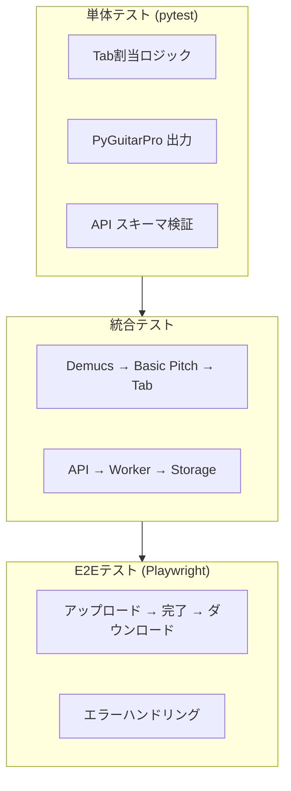

# テスト計画

## 現在の検証範囲

- BackendはAPI/workerのモック中心と、440Hz合成音に対するBasic Pitchスモークを実装済み。
- Frontendはアップロード画面のコンポーネントテストを実装済み。
- 実ベース音源のノート精度、リズム精度、修正操作数は未評価。
- Playwright E2Eと実Demucsを含むパイプライン品質テストは未実装。

> [!IMPORTANT]
> 機能テストと採譜品質評価を分けます。品質評価の実装順序は [ROADMAP.md](ROADMAP.md) を正本とします。

## 目標テスト戦略



## 単体テスト (pytest)

前提: `basic-pitch` は TensorFlow を引き込まないために **手動で no-deps インストール**する。

```bash
cd backend
uv sync --locked --dev
uv pip install --no-deps basic-pitch==0.4.0
```

### テスト対象

| モジュール | テスト内容 |
|:---|:---|
| `pipelines.separation` | Demucs ラッパーの入出力パス生成、例外伝搬 |
| `pipelines.transcription` | Basic Pitch ラッパーの MIDI 出力検証 |
| `logic.tab_assignment` | 弦/フレット決定ロジック、運指コスト計算 |
| `logic.gp_writer` | GP5 書き出し → 再読込で弦/フレット一致 |
| `api.schemas` | Pydantic スキーマのバリデーション |

### テスト例

```python
# tests/test_tab_assignment.py
import pytest
from logic.tab_assignment import assign_fret

def test_open_string_e1():
    """E1 (MIDI 28) は4弦開放"""
    string, fret = assign_fret(midi_note=28, tuning=[28, 33, 38, 43])
    assert string == 4
    assert fret == 0

def test_high_note_g3():
    """G3 (MIDI 55) は1弦12フレット"""
    string, fret = assign_fret(midi_note=55, tuning=[28, 33, 38, 43])
    assert string == 1
    assert fret == 12
```

## 統合テスト

### パイプライン統合

```python
# tests/integration/test_pipeline.py
import pytest
from pathlib import Path

def test_full_pipeline(tmp_path: Path, sample_audio: Path):
    """Demucs → Basic Pitch → Tab 割当の統合テスト"""
    from pipelines.separation import separate_bass
    from pipelines.transcription import transcribe_midi
    from logic.tab_assignment import generate_gp5

    # 1. 音源分離
    bass_wav = separate_bass(sample_audio, tmp_path)
    assert bass_wav.exists()

    # 2. MIDI変換
    midi_file = transcribe_midi(bass_wav, tmp_path)
    assert midi_file.exists()

    # 3. GP5生成
    gp5_file = generate_gp5(midi_file, tmp_path)
    assert gp5_file.exists()
```

### Transcription ONNX スモーク

```bash
cd backend
uv sync --locked --dev
uv pip install --no-deps basic-pitch==0.4.0
BASIC_PITCH_MODEL_SERIALIZATION=onnx uv run pytest tests/integration/test_transcription.py -q
```

### API 統合

```python
# tests/integration/test_api.py
import pytest
from httpx import AsyncClient

@pytest.mark.asyncio
async def test_job_lifecycle(client: AsyncClient, sample_audio: bytes):
    # ジョブ作成
    response = await client.post(
        "/jobs",
        files={"file": ("test.mp3", sample_audio, "audio/mpeg")}
    )
    assert response.status_code == 202
    job_id = response.json()["job_id"]

    # ステータス確認 (ポーリング)
    for _ in range(60):
        status = await client.get(f"/jobs/{job_id}")
        if status.json()["status"] in ("SUCCESS", "FAILURE"):
            break
        await asyncio.sleep(1)

    assert status.json()["status"] == "SUCCESS"
```

## スモーク (API/Worker)

- 目的: API と Celery ワーカーの起動・疎通を最小限で確認する。
- 内容: Demucs/Basic Pitch/GP5 生成はテスト内でモックし、ジョブ作成 → ステータス取得フローのみ確認（重いモデル依存を避ける）。Basic Pitch は ONNX モデルを no-deps で導入。

### 手順 (ホストで実行)

```bash
cd backend
uv sync --locked --dev
uv pip install --no-deps basic-pitch==0.4.0
uv run pytest tests/integration/test_smoke_pipeline.py -q
```

### 手順 (Docker Compose 内で実行)

```bash
# GPU 版（事前に api イメージへ basic-pitch を no-deps でインストール済み）
docker compose run --rm api uv run pytest tests/integration/test_smoke_pipeline.py -q
# CPU 版
docker compose -f docker-compose.cpu.yml run --rm api uv run pytest tests/integration/test_smoke_pipeline.py -q
```

## ヘルスチェック

- API の liveness: `curl -f http://localhost:${API_PORT:-8000}/health`
- コンテナ内から確認する場合:

```bash
docker compose exec api curl -f http://localhost:8000/health
```

200 が返れば FastAPI が起動し、Redis への依存が満たされていることを示す。

## E2E テスト (Playwright、未実装)

### テストシナリオ

| シナリオ | 手順 | 期待結果 |
|:---|:---|:---|
| 正常系 | アップロード → 待機 → プレビュー → ダウンロード | GP5 がダウンロードされ、AlphaTab で表示される |
| エラー系 | 不正なファイルをアップロード | エラーメッセージが表示され、ポーリングが停止 |
| キャンセル系 | アップロード後にキャンセル (Phase 3) | ジョブがキャンセルされ、リソースが解放される |

### テスト例

```typescript
// tests/e2e/upload.spec.ts
import { test, expect } from '@playwright/test';

test('upload and download bass tab', async ({ page }) => {
  await page.goto('/');

  // ファイルアップロード
  const fileInput = page.locator('input[type="file"]');
  await fileInput.setInputFiles('./fixtures/sample.mp3');
  await page.click('button:has-text("Upload")');

  // 進捗待機
  await expect(page.locator('[data-testid="status"]'))
    .toHaveText('SUCCESS', { timeout: 300000 });

  // ダウンロード確認
  const [download] = await Promise.all([
    page.waitForEvent('download'),
    page.click('a:has-text("Download")')
  ]);
  expect(download.suggestedFilename()).toMatch(/\.gp5$/);
});
```

## 評価データと採譜品質

公開データセットは、数量、ライセンス、保存方法を合意するまで一括ダウンロードしません。

- **現時点で利用可能な正解MIDIはありません。** 当面は生成したBass StemとMIDIの聴感比較を
  主な評価方法とし、正解依存の指標は正解MIDIを入手または作成できた後に使用します。
- 初期ベンチマークはユーザーが用意する数曲の短い区間を入力可能にする。
- 正解MIDIがある場合はonset/offset/frame F1等を計測する。
- 正解MIDIがない場合も、モデル・パラメータ別成果物、聴感、修正量を比較可能にする。
- 曲数、区間長、正解作成、公開データの利用範囲は実装前に相談して決定する。

### Phase A ベンチマークCLI

Web workerを介さず同じ入力を処理し、生成されたBass Stem、Raw MIDI、Performance MIDIを
耳で比較できます。`--reference` は任意です。

```bash
cd backend
uv sync --locked --dev
./scripts/install_basic_pitch.sh

uv run python -m src.evaluation.benchmark \
  --audio /path/to/song.wav \
  --output-dir /tmp/stem2tab-benchmark
```

既定条件は `direct × basic_pitch` です。Demucsを含める場合は
`--separators direct,demucs` を指定します。separatorは1回だけ実行され、その出力を選択した
全transcriberで共有します。ローカルのDemucsモデルキャッシュは既定で
`<カレントディレクトリ>/.cache/demucs/` を使用し、Docker向けの `/data` は使用しません。

主な既定評価条件:

| 指標 | 既定値 |
|:---|:---|
| onset許容 | 50 ms |
| pitch許容 | 50 cents |
| offset許容 | 正解音価の20%、最低50 ms |
| frame間隔 | 10 ms |

許容値は `--onset-tolerance-ms`、`--pitch-tolerance-cents`、`--offset-ratio`、
`--offset-min-tolerance-ms`、`--frame-hop-ms` で変更でき、manifestへ記録されます。
正解MIDIを指定した場合だけ、onset/onset+offsetは `mir_eval`、frame F1、extra/missed、
duration MAE、±12半音のoctave errorは共通ノートイベントから算出します。

```bash
uv run python -m src.evaluation.benchmark \
  --audio /path/to/song.wav \
  --reference /path/to/reference.mid
```

各runにはBasic Pitchの `raw.mid`、標準化した `events.json` / `events.csv`、
`performance.mid`、依存追加なしの簡易Bass音色で音声化した `preview.wav`、`metrics.json` を
保存します。ルートには `comparison.json`、`comparison.csv`、`report.md`、入力SHA-256や
環境情報を持つ `manifest.json` を保存します。

`report.html` では、元曲、分離Bass Stem、各MIDIプレビューを同じ再生位置で切り替えられます。
評価したい区間でA点とB点を設定するとループ再生できます。ローカルファイル再生がブラウザに
拒否される場合は、成果物ディレクトリで `uv run python -m http.server 8765` を実行して
`http://localhost:8765/report.html` を開きます。

正解MIDIなしでは正解依存の指標を空欄にし、ノート数と処理時間を記録します。Score MIDIと
拍量子化はPhase Dの対象です。

新規評価テストは実モデルをロードせず、短い合成ノートと一時生成MIDIで実行します。

```bash
cd backend
uv run pytest \
  tests/unit/test_evaluation_models_io.py \
  tests/unit/test_evaluation_metrics.py \
  tests/unit/test_evaluation_preview.py \
  tests/unit/test_evaluation_adapters.py \
  tests/unit/test_evaluation_benchmark.py -q
```

## パフォーマンステスト

### SLO (Service Level Objectives)

| 曲の長さ | CPU | GPU |
|:---|:---|:---|
| 2分 | < 8分 | < 2分 |
| 4分 | < 15分 | < 5分 |
| 6分 | < 20分 | < 8分 |

### ベンチマーク

```bash
# パフォーマンス計測スクリプト
hyperfine \
  --warmup 1 \
  --runs 3 \
  'python -m pipelines.run_benchmark fixtures/4min_song.mp3'
```

## テストデータ

### フィクスチャ

| ファイル | 説明 |
|:---|:---|
| `fixtures/audio/sample.wav` | 1秒の音声スモーク用フィクスチャ |
| `fixtures/golden/basic_pitch.json` | ノートイベント形式の暫定スタブ。品質評価用正解データではない |
| ユーザー提供音源 | 初期ベンチマーク用。リポジトリ同梱の可否は別途判断 |

### モデルキャッシュ

- CI では事前にモデルをダウンロードし、キャッシュとしてマウント。
- オフラインテスト用にモック/スタブを用意。

## CI/CD 統合

```yaml
# .github/workflows/ci.yml
name: Test
on: [push, pull_request]

jobs:
  test:
    runs-on: ubuntu-latest
    steps:
      - uses: actions/checkout@v4

      - name: Install uv
    uses: astral-sh/setup-uv@v4

      - name: Install dependencies
    run: uv sync --locked --dev

  - name: Install Basic Pitch (ONNX only)
    run: uv pip install --no-deps basic-pitch==0.4.0

      - name: Run unit tests
    env:
      BASIC_PITCH_MODEL_SERIALIZATION: onnx
    run: uv run pytest tests/unit -v

      - name: Run integration tests
    env:
      BASIC_PITCH_MODEL_SERIALIZATION: onnx
    run: uv run pytest tests/integration -v

  e2e:
    runs-on: ubuntu-latest
    needs: test
    steps:
      - uses: actions/checkout@v4
      - name: Start services
        run: docker compose up -d
      - name: Run Playwright tests
        run: npx playwright test
```

## 補助スクリプト

ルートの `Makefile` でよく使うタスクをまとめています。

```bash
# GPU compose 起動
make dev-gpu
# CPU compose 起動
make dev-cpu
# backend テスト (Basic Pitch ONNX no-deps 導入込み)
make test-backend
# frontend テスト＋ビルド
make test-frontend
```

## GP5 container regression

Run from `backend` with the existing environment:

```bash
python -B -m pytest tests/unit/test_tab.py -q -p no:cacheprovider
```

These tests synthesize temporary MIDI, invoke the GP5 converter, and parse the
result with PyGuitarPro. They verify mapped pitch/order preservation, unchanged
input MIDI hashes, one intended track/header, mapping boundaries, and rest-only
containers. MusicXML writing is stubbed to isolate this GP5 regression.

The fix only removes blank default Song/Track containers that previously caused
the writer to omit the populated measure. It retains the existing tuning
`[40,45,50,55]`, fret range `0..24`, playback program/velocity, and sequential
quarter-note durations. It does not preserve performed rhythm, add bars or
voices, correct bass tuning, change MusicXML, or establish transcription quality.
Empty/single-onset tempo-estimation fallback behavior is also outside this fix;
the empty-container test supplies a tempo explicitly.

## Opt-in saved-MIDI bass output tests

See [SAVED_MIDI_BASS_TRIAL.md](evaluation/SAVED_MIDI_BASS_TRIAL.md) for the
explicit CLI, restrictions and complete relevant test command. Use only
synthetic fixtures; retain original MIDI and unknown reference accuracy.

## Opt-in saved-MIDI Web tests

See [SAVED_MIDI_WEB_TRIAL.md](evaluation/SAVED_MIDI_WEB_TRIAL.md) for API bounds,
artifact distinctions and the actual-browser gate. Add `tests/unit/test_midi_trials_api.py`
to the saved-MIDI backend suite. Run `npm test -- --run` after frontend changes,
then `npm run build` and `node node_modules/typescript/bin/tsc --noEmit`.
Mocked player callbacks do not substitute for visible SVG/transport checks.
Preserve separate evidence for input selection, note pitch/count, cursor/time,
pause/stop/seek, blocked range and re-input cleanup; never infer musical accuracy
from successful rendering. Private MIDI is not a committed test fixture.

The saved-result route `/midi-trial/saved/<trial UUID>` must issue only a GET,
validate the UUID and returned summary identity, reject malformed/error replies,
and abort stale reads on navigation/unmount. Test the default import flow too.
For cursor visibility, inspect the real browser: the saved-MIDI viewer alone
supplies a red beat cursor and translucent blue bar highlight. Confirm position
changes during playback and seek, and reset on stop; mocked DOM tests cannot
establish visual visibility. Keep the user's original tab and file selection.

## Opt-in local MuScriptor route checks

Decoder regressions cover backward absolute shifts, nonpositive note lengths,
raw artifact retention after failure, and direct worker-file execution from a
different directory. The strict policy rejects malformed output without
clamping timestamps, dropping notes, or retrying the model. Successful output
keeps the original notes and literal MIDI serialization.

Run `pytest tests/unit/test_muscriptor_trials_api.py tests/unit/test_muscriptor_worker.py tests/unit/test_muscriptor_decoder.py`
with the existing backend environment, plus the saved-MIDI/API and evaluation unit
modules when changing shared conversion. Fixtures are generated synthetic data; heavy
backends are mocked and tests require no downloaded models or private audio.
Run `npm test` and `npm run build` after frontend changes. The existing TypeScript
baseline errors must be reported separately from new errors.

The route's functional real-clip check is documented in
[MUSCRIPTOR_OPT_IN_TRIAL.md](evaluation/MUSCRIPTOR_OPT_IN_TRIAL.md). It must retain
raw output, verify MIDI/XML event correspondence within their rounding bounds,
check terminal failure/no-fallback/reentry, and distinguish backend integration from
manual file-input testing. Never invent precision/recall/F1 for unverified RWC labels.

## Optional constrained fingering and explicit rhythm

See [BASS_NOTATION_TRIAL.md](evaluation/BASS_NOTATION_TRIAL.md). Run these new modules
with the existing backend environment, then the existing evaluation, bass-output,
MIDI/API and worker regression suites:

```bash
python -m pytest tests/unit/test_bass_fingering.py tests/unit/test_explicit_rhythm.py tests/unit/test_evaluation_bass_notation_trial.py -q
```

The 60 new tests cover string occupancy during original note intervals, open strings,
bass4/bass5/custom tuning, range rejection without transposition, position/hand-span
constraints, search caps, no partial GP5, explicit clock validation, short-note
collapse, onset merging, overlap changes, rests, repeated pitches, bar-crossing ties,
and exact MusicXML readback through an independent music21 parser. Original MIDI
bytes and storage-clock MusicXML must remain preserved. The complete relevant suite
passed 237 tests on NAJA (one existing FastAPI `on_event` deprecation warning).

For a visual check, use a synthetic score with an explicit clock and the installed
AlphaTab assets through the permitted browser tool. A rendered glyph or successful
transport is not an auditory or transcription-quality verdict. Keep independent
test/audit evidence separate from live browser file-selection coverage. No frontend
application source changed in this stage; previous frontend results remain 42 tests
and build passed, with 11 known pre-existing TypeScript errors, not a new clean tsc run.
# Local listening and notation regression

Raw clock guards also run `test_evaluation_midi_clock.py`: conductor/nonconductor
tempo and meter changes, rejection before normalization/output, unchanged source
bytes, duplicate clock declarations and legacy saved-source revalidation. API
regressions require the specific `unsupported_midi_clock` refusal.

Run `pytest tests/unit/test_evaluation_*.py` plus the existing bass/output/API
regressions after these changes. New focused modules are
`test_notation_trials_api.py` and `test_rhythmic_gp5.py`. They cover idempotency,
unchanged source bytes, explicit deltas, unsupported clock fallback,4/5/6strings,
short notes, rests, repeated attacks, staggered chords and barline ties.
Frontend: `npm test -- --run`, `npm run build`, and `npx tsc --noEmit`.
No lint script is currently configured. Existing typecheck failures are reported
separately, never treated as successful type validation.

Browser checks must include rapid source selection, loop/end boundaries,
pause/stop/replay, invalid intervals, interrupted-result recovery, original versus
derived labels, logical pitch/count, cursor and playback time. Synthetic explicit
clock examples do not establish real-song tempo or transcription accuracy.
See [local trial contract](evaluation/LOCAL_LISTENING_NOTATION_UI.md).

The [original-time cursor/TAB regression](evaluation/score-cursor-tab.md) adds
`frontend/src/test/scoreGeometry.test.ts` with real alphaTab parsing/rendering of
synthetic XML. Browser playback must cover late second-bar rests, barline ties,
the next system, seek/pause/stop/replay, and repeated TAB toggles. A constant
tempo does not imply constant pixel velocity on non-proportional printed spacing.

Notation-clock rebarring regression: `test_evaluation_notation_clock.py` reads
synthetic XML back with exact rational arithmetic, covering ties, rests, bar
boundaries, polyphony, repeated/one-tick notes, and original full-bar tail duration.
API tests check repeated GETs leave all saved files unchanged, reject changed or
incompatible sources, and never invoke models. `MidiTrial`/`MidiTrialViewer`
tests distinguish the candidate from quantization and ignore stale player events.
The real-song audit is local only, never a test fixture or accuracy reference.
See [notation-clock contract](evaluation/notation-clock.md).

Time-proportional view: `frontend/src/test/timeScore.test.tsx` uses synthetic
MusicXML and the real alphaTab loader/player generator. It checks equal-time
cursor distances, exact attack alignment, ties across rows, rests, short repeated
notes, 4/5/6 strings and unchanged playback events. Meter changes, repeats and
unverified ties must fail explicitly. Viewer tests cover disposal/stale callbacks
when switching spacing. Browser checks measure DOM glyph/cursor coordinates,
fixed-tempo beat intervals, row/bar crossings and seek/pause/stop/display changes.
`spacing=time` explicitly selects this display; normal engraving remains default.

The current time view reuses alphaTab 1.7.1 engraving instead of custom SVG glyphs.
`libraryTimeLayout.test.ts` checks playback-time column placement, unchanged
glyph/model data, unsupported layouts and measured note/TAB alignment guards.
The former `timeNotation` code/tests remain historical, unused by the viewer.
`playbackTransport.test.ts` injects delayed pause/stop/play/seek notifications,
the SDK's automatic beat-start rewind, buffered samples, rapid newer intents,
missing acknowledgements, natural completion and disposed players. Browser
checks must compare the original engraving, every barline and bass clef, and
measure pause stability, seek/replay/stop and equal-time cursor distances. A
successful raw-time display is not a verified musical quantization or tempo.

## 通常導線と型チェックの追加回帰

[クラウド統合検証](evaluation/CLOUD_INTEGRATION.md) に、通常ジョブの生成MIDI→原時刻版→
任意補正の検証範囲と手順を記載しています。frontendでは `npm test -- --run`、
`node node_modules/typescript/bin/tsc --noEmit`、`npm run build` を実行します。
backendの `test_workflow_integration.py` は推論を模擬し、保存MIDIとGP5出力は実際の処理で確認します。
通信待機の中断はサーバー処理の取消ではなく、保存IDで確認することをテストします。
